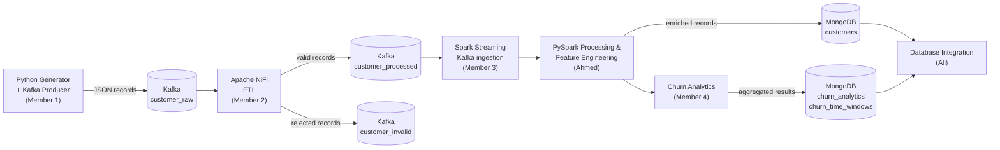

# Architecture — Customer Churn Analytics

Real-time Big Data pipeline that generates customer records, transforms them with NiFi,
analyzes them with Spark Structured Streaming, and stores results in MongoDB.

## High-level data flow

